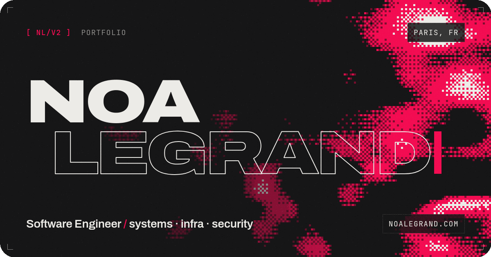

# Portfolio v2

<p align="center">
	
</p>

My personal portfolio, live at **[noalegrand.com](https://www.noalegrand.com/)**.

A ground-up redesign: black, bone and cool red, a tech HUD look with printed textures (film grain, scanlines, ink-brush strokes, ordered dithering).
Vanilla HTML, CSS and JavaScript — no framework, no build step, no dependencies. Hosted on GitHub Pages.

## Highlights

- **Live dithered field** — the hero background is domain-warped noise rendered through a 4×4 Bayer matrix on a low-res canvas, reacting to the cursor. Pauses when off screen.
- **Dithered portrait** — the about photo is dithered in the browser and wipes to the original on hover.
- **Data-driven content** — projects, skills and experience are rendered from JSON files.
- **Light on bandwidth** — self-hosted variable fonts, WebP images, 720p videos that only load near the viewport, with poster frames.

## Structure

```
index.html                 the page
css/main.css               all styles
js/main.js                 rendering, animations, HUD
resources/jsons/           content: projects, skills, experience
resources/noa/             photos, videos, poster frames, social card
resources/svgs/skills/     skill icons
resources/fonts/           Archivo + JetBrains Mono (OFL)
tools/og-card.html         source of the social preview image
```

## Run locally

The content is loaded with `fetch`, so serve the folder rather than opening the file directly:

```sh
python3 -m http.server 8000
```

Then open <http://localhost:8000>.

## Editing content

- **Projects** — `resources/jsons/projects.json`. `categories` drives the filters, `links` is `[title link, source, live site]` (`"none"` to hide one). A `video` takes priority over an `image`; with neither, a textured placeholder is shown. Each video needs a `.poster.webp` next to it.
- **Skills** — `resources/jsons/skills.json`, grouped by category.
- **Experience** — `resources/jsons/experience.json`. `start`/`end` are `YYYY` or `YYYY-MM`; leave `end` as `null` for ongoing.

To regenerate the social preview (`resources/noa/Social.png`), serve the repo, open `tools/og-card.html` and capture it at 1200×630.

## License

See [LICENSE.md](./LICENSE.md). Fonts are under the SIL Open Font License (see `resources/fonts/*/OFL.txt`).
